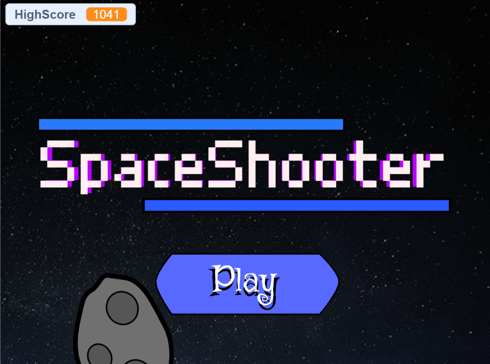
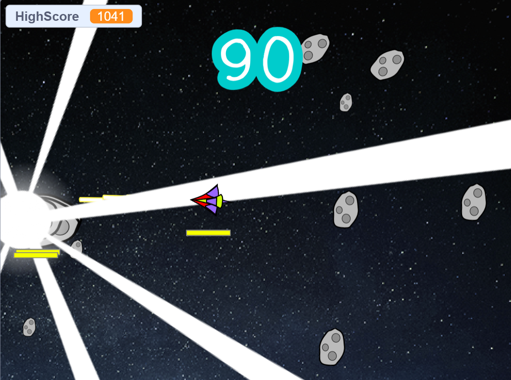

# 🚀 Space Shooter

## 📖 About the Game

**Space Shooter** adalah game bergenre **Shoot 'em Up (Shmup)** yang dikembangkan menggunakan Scratch. Pemain mengendalikan sebuah pesawat untuk menembak dan menghancurkan meteor yang menghadang. Pemain harus menghindari tabrakan dan bertahan selama mungkin untuk mendapatkan skor tertinggi.

## 🎮 Gameplay

- Mengendalikan pesawat untuk bergerak.
- Menembak meteor yang muncul.
- Menghindari meteor agar pesawat tidak hancur.
- Mengumpulkan skor dari meteor yang berhasil dihancurkan.
- Bertahan selama mungkin menghadapi meteor.

## ✨ Features

- Kontrol pesawat sederhana.
- Sistem tembakan.
- Meteor sebagai rintangan.
- Sistem perhitungan skor.
- Tantangan permainan yang semakin meningkat.

## 🛠️ Built With

- **Scratch** – Visual programming platform.
- **Scratch Blocks** – Pemrograman berbasis blok.

## 🕹️ How to Play

1. Jalankan game Space Shooter.
2. Mulai permainan.
3. Gerakkan pesawat untuk menghindari meteor.
4. Tembak meteor yang menghadang.
5. Raih skor tertinggi dan bertahan selama mungkin!

## 📷 Screenshots

### Start Menu

### Gameplay 

---

⭐ Thank you for visiting this repository!

